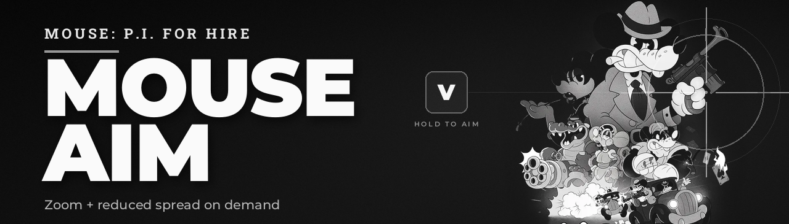

# Mouse Aim

[](docs/images/header-1280x365.png)

Hold a dedicated key to aim in **MOUSE: P.I. For Hire**: the camera zooms in
and weapon spread is reduced.

A small BepInEx 5 plugin. It does not use the game's `AlternateShoot` action, so
it does not interfere with secondary fire or the native scope. The default aim
button is **V**, and it can be changed in **Settings > Controls > Aim key**.

## Features

- Hold **V** to aim, release to return to the normal view.
- Smooth camera FOV zoom.
- Reduced weapon spread while aiming.
- The crosshair tightens automatically because the game derives its size from
  the same spread value.
- Dedicated, configurable aim button: any keyboard key or mouse button.
  Click **Settings > Controls > Aim key**, then press the key you want in the
  same rebinding popup used by the other Commands entries.
- Works alongside the **Mouse Double Tap Dash** mod.

## What version 1.3.2 does not do

- No weapon animation or weapon pose change: the weapon stays in its normal
  pose while aiming.
- No sensitivity change.
- No recoil change.
- Generic aim is skipped while a weapon's secondary ability is active
  (native scope or alternate fire), to avoid stacking two zoom effects.

## Requirements

- **MOUSE: P.I. For Hire** (tested with the 14/10/2026 build).
- **BepInEx 5.4.23.5 x64**, using the game-specific **unstripped** setup for
  MOUSE: P.I. For Hire.
  - Nexus: **Unstripped BepInEx for M.P.I.**, or the equivalent package on ModDB.
  - Do **not** use a stock BepInEx package: the game ships stripped BCL
    assemblies and the preloader will fail.
- Single-player. No anti-cheat is involved.

## Installation

1. Install the unstripped BepInEx package into the game root (the folder that
   contains `MOUSE.exe`).
2. Launch the game once, then check that `BepInEx/LogOutput.log` exists.
3. Extract `MouseAim-1.3.2.zip` into the game root. The result must be:

   ```
   <game>/BepInEx/plugins/MouseAim.dll
   ```

4. Launch the game. Hold **V** while a weapon is drawn.

## Configuration

File: `BepInEx/config/com.cono.mouseaim.cfg`

```ini
[General]
Enabled = true
AimButton = V
AimGamepadBinding = <Gamepad>/leftShoulder

[Zoom]
AimZoomDegrees = 28
AimTransitionSeconds = 0.08

[Accuracy]
AimSpreadMultiplier = 0.5

[Conditions]
RequireWeaponDrawn = true

[Debug]
Verbose = false
```

| Option | Description |
| --- | --- |
| `Enabled` | Enables or disables the mod. |
| `AimButton` | Hold this button to aim. Keyboard/mouse binding path, changed through **Settings > Controls > Aim key**. `RightMouse` may conflict with the game's secondary fire or native scope. |
| `AimGamepadBinding` | Gamepad binding path, changed through the same **Aim key** row. |
| `AimZoomDegrees` | FOV reduction while aiming, in degrees. Set to `0` for accuracy only. |
| `AimTransitionSeconds` | Zoom transition duration. |
| `AimSpreadMultiplier` | Spread multiplier while aiming. `0.5` halves the spread. Set to `1` for zoom only. |
| `RequireWeaponDrawn` | Only allow aiming when a weapon is drawn. |
| `Verbose` | Log aim start/stop events. |

Change the values in the file and restart the game.

The aim key can also be changed in **Settings > Controls > Aim key**. Click the
row, then press the keyboard key or mouse button you want. This uses the game's
native Commands rebinding popup. The choice is saved to the BepInEx config
immediately.

## Build from source

Requirements:

- .NET SDK (tested with .NET 9).
- A local copy of **MOUSE: P.I. For Hire** with the unstripped BepInEx package
  installed, so the game and BepInEx references can be resolved.

```bash
git clone git@github.com:Drasenix/mouse-pi-aim.git
cd mouse-pi-aim

MOUSE_GAME_DIR="/path/to/MOUSE" \
  dotnet build src/MouseAim.csproj -c Release -o out
```

Then copy `out/MouseAim.dll` to `<game>/BepInEx/plugins/`.

You can also pass the game path directly:

```bash
dotnet build src/MouseAim.csproj -c Release -o out \
  -p:GameDir="/path/to/MOUSE"
```

## How it works

- A custom `IFOVModifier` is added to the game's `CameraFOVController`, so the
  zoom respects the game's base FOV, lens distortion, and ultrawide handling.
- A Harmony postfix on `PlayerWeaponController.TotalSpread` applies
  `AimSpreadMultiplier` while aiming. The game's crosshair uses
  `TotalSpread()`, so the crosshair tightens as well. Patching the player
  method also avoids affecting enemy weapon spread.
- The aim state is disabled in menus, pause, photo mode, while the weapon is
  holstered or changing, and while a secondary ability is active.

## Changelog

See [CHANGELOG.md](CHANGELOG.md).

## Credits

- BepInEx Team and HarmonyX.
- KZekai and the authors of the unstripped BepInEx setup for
  MOUSE: P.I. For Hire.
- Fumi Games for the game.

## License

Plugin code is released under the MIT license. See [LICENSE](LICENSE).

Do not redistribute the game's assemblies or the BepInEx unstripped package
without following their respective licenses.
